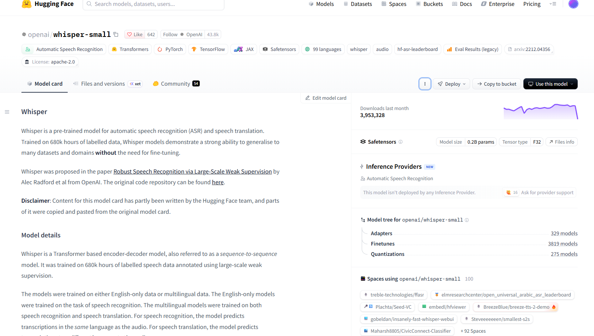

Murciélago come manzanas

\# Portafolio de Jorge Andrés Ruiz López

Herramientas de Procesamiento para IA · Ibero León · Otoño 2026

\## Sobre mí

Estudio Ingeniería en IA y me interesa el \*\*procesamiento de lenguaje natural\*\*.

\## Prácticas- \[Práctica 3: README del proyecto](practica-3/README.md)

pandurin397-cell

[Ficha del proyecto con diagrama ](prácticas 2 y 3)](practica-3/README.md)

[Mis comandos de terminal y Git (Práctica 4)](notas/comandos.md)

[Repositorio del equipo](https://github.com/doripil-cloud/in1050-B4-Transcripcion)

https://huggingface.co/openai/whisper-small

